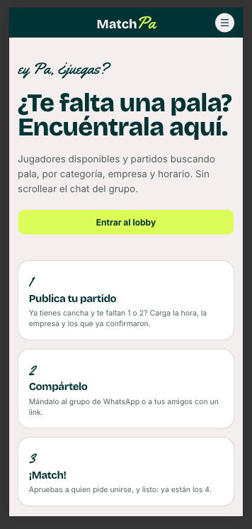
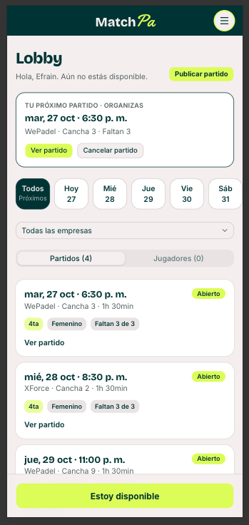
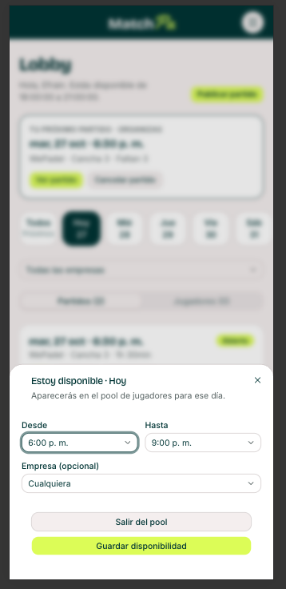
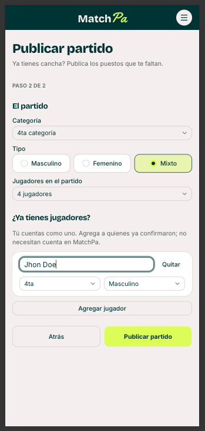
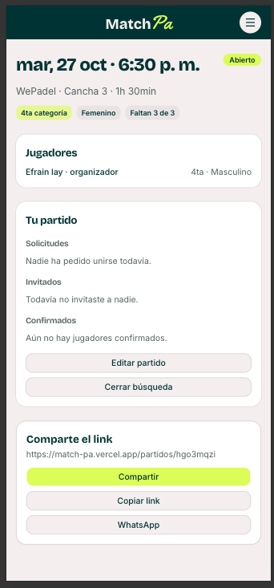

# MatchPa 🎾

> **Match** de búsqueda para jugadores + **Pa** de Panamá y del "ey Pa" de barrio.

Plataforma social de pádel para completar partidos y encontrar jugadores. Pensada para crecer a torneos y más deportes.

🌐 **[match-pa.vercel.app](https://match-pa.vercel.app/)**

## Capturas

<table>
<tr>
<td align="center" width="33%"><br/><sub><b>Home</b>: página de inicio</sub></td>
<td align="center" width="33%"><br/><sub><b>Lobby</b>: partidos y jugadores del día, ordenados por tu categoría</sub></td>
<td align="center" width="33%"><br/><sub><b>Disponibilidad</b>: horario por día y sucursal</sub></td>
</tr>
<tr>
<td align="center" width="33%"><br/><sub><b>Publicar partido</b>: formulario en dos pasos</sub></td>
<td align="center" width="33%"><br/><sub><b>Detalle</b>: puestos, solicitudes y link para compartir</sub></td>
<td></td>
</tr>
</table>

## El problema

Las sucursales con canchas de pádel (WePadel, XForce…) tienen grupos de WhatsApp donde se repite a diario:

> "¿Quién disponible para las 6pm? Buscamos pala de 4ta categoría"
>
> "Partido mixto — Sacha, Efrain, Esteban. Buscamos una pala disponible"

La cancha ya está reservada (sucursal, # de cancha, hora), el partido es de 4 y dura 1h30 o 2h, y casi siempre falta 1. El mensaje se pierde en el chat.

## La solución (MVP)

1. **Publicar partido:** el organizador carga fecha, hora, sucursal, cancha, categoría, tipo y los jugadores que ya tiene. Se muestran los puestos disponibles.
2. **Compartir:** el partido genera un link público para el grupo de WhatsApp o amistades.
3. **Unirse:** un jugador pide unirse o el organizador lo invita desde el pool ("Ey Pa, ¿juegas?"). El organizador aprueba.
4. **Disponibilidad:** un jugador se postula para un día y queda visible en el pool.
5. **Cierre:** al llenarse los puestos: **¡Match!** El organizador también puede cerrarlo antes; si no, expira a la hora de la reserva.

## Stack

| Capa | Tecnología |
|---|---|
| Frontend | Next.js (App Router), TypeScript, Tailwind CSS, shadcn/ui, TanStack Query |
| Backend | AdonisJS 7, Lucid, VineJS, Japa |
| Base de datos | PostgreSQL (Docker en local, Neon en producción) |
| Tiempo real | AdonisJS Transmit (SSE) |
| Notificaciones | Web Push con VAPID |
| Despliegue | Vercel (frontend), Render (backend), Neon (base de datos) |

## Inicio rápido

Requisitos: Node.js 24 LTS y Docker.

```bash
docker compose up -d

cd backend
cp .env.example .env
npm install
node ace generate:key      # copia la clave en APP_KEY dentro de backend/.env
node ace migration:run
node ace db:seed
node ace serve --hmr
```

En otra terminal:

```bash
cd frontend
cp .env.example .env.local
npm install
npm run dev
```

Abre [http://localhost:3000](http://localhost:3000). Variables, datos de prueba y tests en [desarrollo local](docs/desarrollo-local.md).

## Documentación

| Documento | Contenido |
|---|---|
| [Reglas de negocio](docs/reglas-de-negocio.md) | Partidos, solicitudes, disponibilidad, categorías y sucursales |
| [Modelo de datos](docs/modelo-de-datos.md) | Tablas y columnas |
| [API](docs/api.md) | Endpoints y acciones |
| [Frontend](docs/frontend.md) | Mobile first y rutas |
| [Tiempo real](docs/tiempo-real.md) | Canales Transmit, push y modal opt-in |
| [Seguridad](docs/seguridad.md) | Datos sensibles, sesión y límites |
| [Analítica](docs/analitica.md) | GA4 por Tag Manager y eventos del embudo |
| [Brandbook](docs/brandbook.md) | Colores, tipografía, logo y tono |
| [Desarrollo local](docs/desarrollo-local.md) | Instalación, datos de prueba y variables |
| [Despliegue](docs/despliegue.md) | Vercel, Render, Neon y sus variables |
| [Desarrollo con IA](docs/desarrollo-con-ia.md) | Agentes, skills y flujo de trabajo |
| [Roadmap](docs/roadmap.md) | Lo hecho y lo que sigue |
| [Arquitectura](docs/arquitectura.html) | Diagrama interactivo |

## Estado

- **Desarrollo:** MVP en curso. Lo hecho y lo pendiente está en el [roadmap](docs/roadmap.md).
- **Despliegue:** en configuración con planes gratuitos (Vercel, Render y Neon). Ver [despliegue](docs/despliegue.md).

## Contribuir y licencia

Por ahora no se aceptan contribuciones externas. Licencia pendiente de definir.
