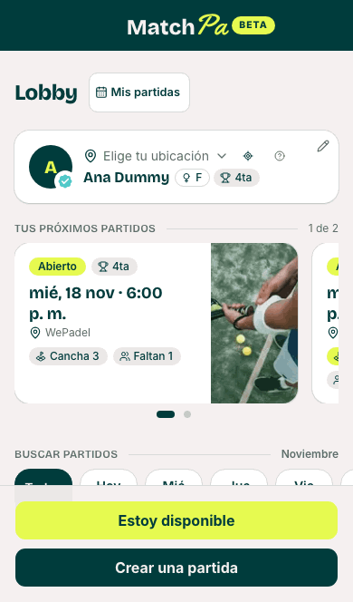
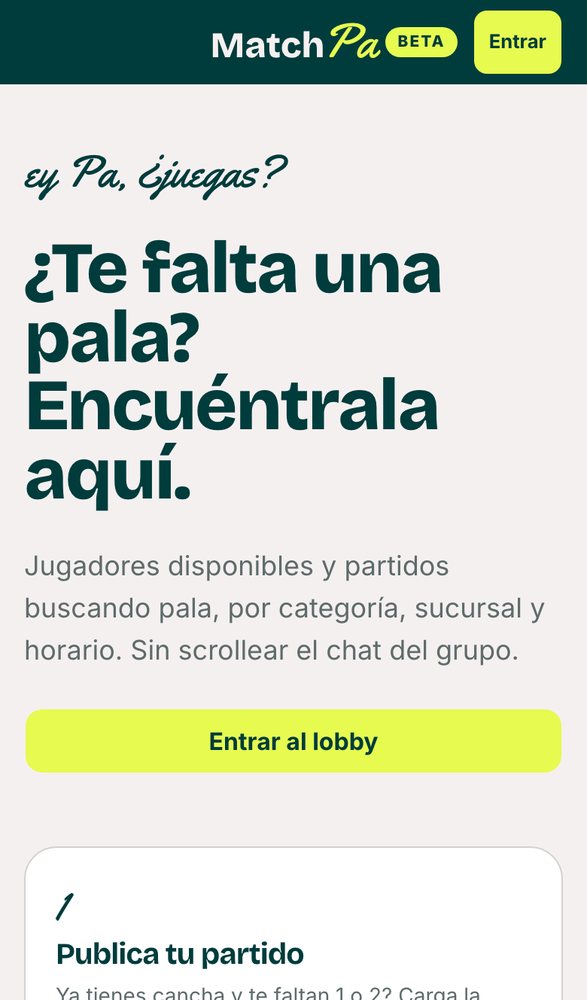
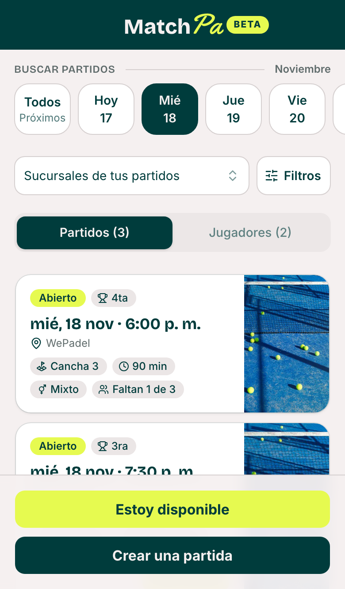
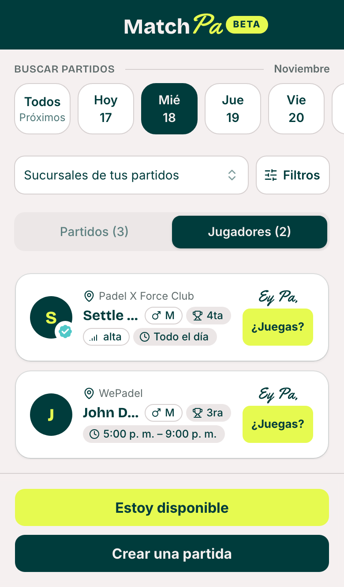
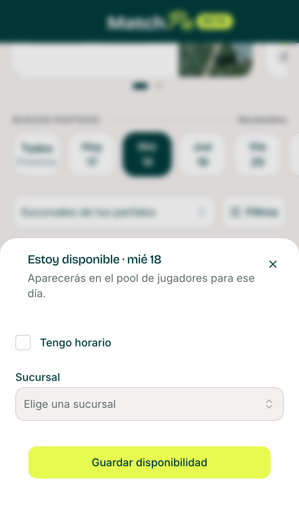
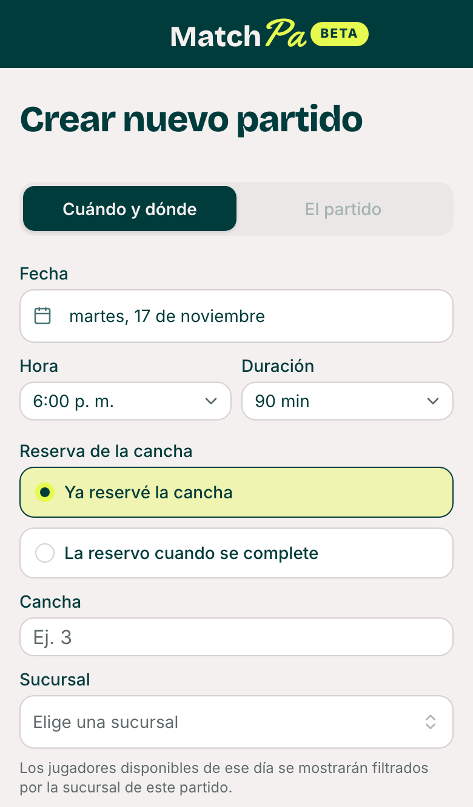
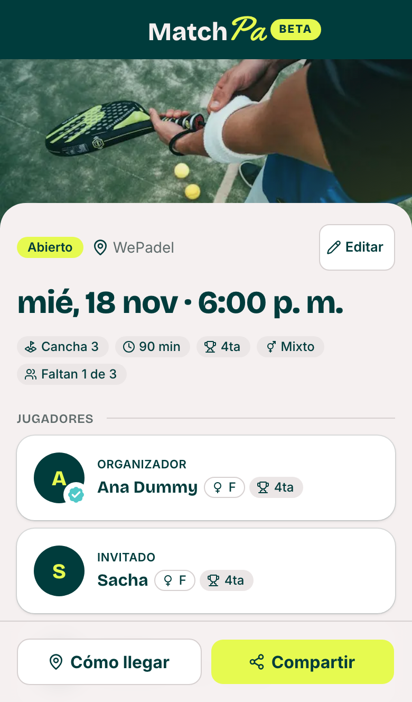
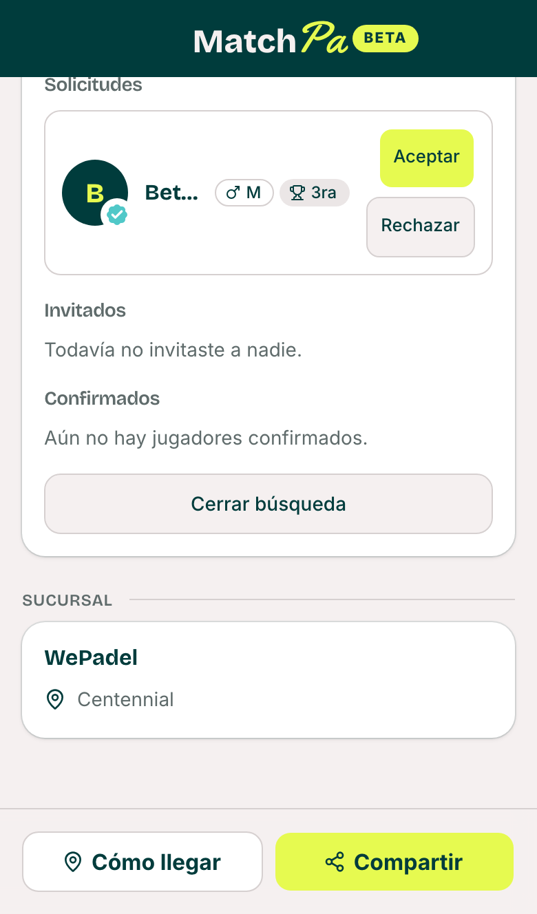
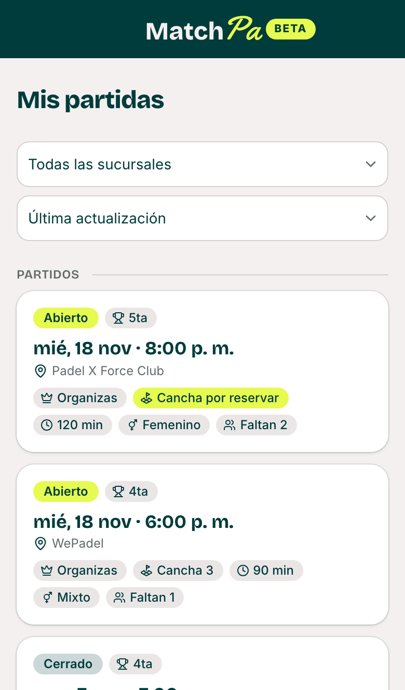
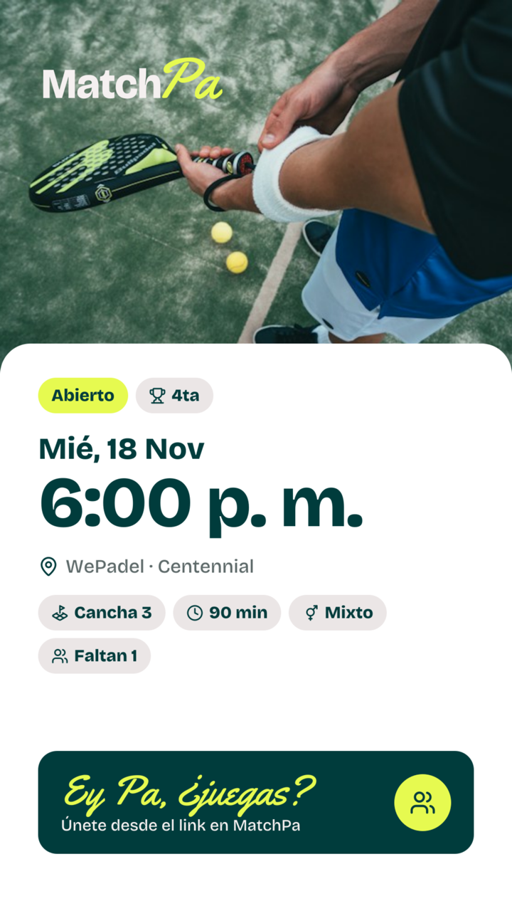

# MatchPa 🎾

> **Match** de búsqueda para jugadores + **Pa** de Panamá y del "ey Pa" de barrio.

Plataforma social de pádel para completar partidos y encontrar jugadores. Pensada para crecer a torneos y más deportes.

🌐 **[matchpa.app](https://matchpa.app/)**

## Capturas

<p align="center">
<br/>
<sub>Del lobby al detalle: elegir el día, ver jugadores disponibles y revisar las solicitudes</sub>
</p>

<table>
<tr>
<td align="center" width="33%"><br/><sub><b>Home</b>: página de inicio</sub></td>
<td align="center" width="33%"><br/><sub><b>Lobby</b>: tu perfil y tus próximos partidos</sub></td>
<td align="center" width="33%"><br/><sub><b>Partidos</b>: por día, sucursal y filtros</sub></td>
</tr>
<tr>
<td align="center" width="33%"><br/><sub><b>Jugadores</b>: el pool del día, con "Ey Pa, ¿juegas?"</sub></td>
<td align="center" width="33%"><br/><sub><b>Disponibilidad</b>: por día, con horario opcional</sub></td>
<td align="center" width="33%"><br/><sub><b>Publicar partido</b>: con la cancha reservada o por reservar</sub></td>
</tr>
<tr>
<td align="center" width="33%"><br/><sub><b>Detalle</b>: jugadores, cómo llegar y compartir</sub></td>
<td align="center" width="33%"><br/><sub><b>Organizador</b>: aceptar solicitudes, invitar y cerrar</sub></td>
<td align="center" width="33%"><br/><sub><b>Mis partidas</b>: las que organizas o juegas</sub></td>
</tr>
<tr>
<td align="center" width="33%"><br/><sub><b>Historia</b>: imagen 1080×1920 para Instagram</sub></td>
<td></td>
<td></td>
</tr>
</table>

## El problema

Las sucursales con canchas de pádel (WePadel, XForce…) tienen grupos de WhatsApp donde se repite a diario:

> "¿Quién disponible para las 6pm? Buscamos pala de 4ta categoría"
>
> "Partido mixto — Sacha, Efrain, Esteban. Buscamos una pala disponible"

La cancha ya está reservada (sucursal, # de cancha, hora), el partido es de 4 y dura 1h30 o 2h, y casi siempre falta 1. El mensaje se pierde en el chat.

## La solución (MVP)

1. **Publicar partido:** el organizador carga fecha, hora, sucursal, categoría, tipo y los jugadores que ya tiene. La cancha puede ir ya reservada o reservarse cuando el partido se complete. Se muestran los puestos disponibles.
2. **Compartir:** el partido genera un link público con vista previa en WhatsApp y una imagen vertical para historias.
3. **Unirse:** un jugador pide unirse o el organizador lo invita desde el pool ("Ey Pa, ¿juegas?"). El organizador aprueba.
4. **Disponibilidad:** un jugador se postula para un día y queda visible en el pool.
5. **Cierre:** al llenarse los puestos: **¡Match!** El organizador también puede cerrarlo antes; si no, expira a la hora del partido.

Además: solicitudes y cambios en tiempo real, notificaciones push (se instala como PWA), **Mis partidas** con filtros, y registro con Google o correo verificado.

## Stack

| Capa | Tecnología |
|---|---|
| Frontend | Next.js (App Router), TypeScript, Tailwind CSS, shadcn/ui, TanStack Query |
| Backend | AdonisJS 7, Lucid, VineJS, Japa |
| Base de datos | PostgreSQL (Docker en local, Neon en producción) |
| Tiempo real | AdonisJS Transmit (SSE) |
| Notificaciones | Web Push con VAPID |
| Despliegue | Vercel (frontend), Render (backend), Neon (base de datos) |

## Inicio rápido

Requisitos: Node.js 24 LTS y Docker.

```bash
docker compose up -d

cd backend
cp .env.example .env
npm install
node ace generate:key      # copia la clave en APP_KEY dentro de backend/.env
node ace migration:run
node ace db:seed
node ace serve --hmr
```

En otra terminal:

```bash
cd frontend
cp .env.example .env.local
npm install
npm run dev
```

Abre [http://localhost:3000](http://localhost:3000). Variables, datos de prueba y tests en [desarrollo local](docs/desarrollo-local.md).

### Voz para los videos de marketing (opcional)

La voz en off de los videos de `marketing/` se genera en local con [Voicebox](https://github.com/jamiepine/voicebox), una voz clonada que corre en Docker. Va en el perfil `marketing`, así que `docker compose up -d` no lo levanta:

```bash
docker compose --profile marketing up -d --build voicebox
```

- El contenedor usa hasta 10 GB (el modelo Qwen3-TTS 1.7B no cabe en 8): en Docker Desktop → Settings → Resources, sube la memoria a 12 GB.
- La primera vez construye la imagen desde GitHub y descarga los modelos; luego quedan en los volúmenes `voicebox-data` y `voicebox-models`.
- Abre [http://localhost:17600](http://localhost:17600) y crea el perfil de voz con 10–30 s de audio limpio. Usa un motor con español: Qwen3-TTS o Chatterbox Multilingual.
- El nombre del perfil va en la línea **Voz:** del guion (`**Voz:** Voicebox, perfil `efrain``). Después, `node scripts/vo.mjs <slug>` desde `marketing/` genera cada línea y sus tiempos por palabra.
- Para apagarlo: `docker compose --profile marketing stop voicebox`.

## Documentación

| Documento | Contenido |
|---|---|
| [Reglas de negocio](docs/reglas-de-negocio.md) | Partidos, solicitudes, disponibilidad, categorías y sucursales |
| [Modelo de datos](docs/modelo-de-datos.md) | Tablas y columnas |
| [API](docs/api.md) | Endpoints y acciones |
| [Frontend](docs/frontend.md) | Mobile first y rutas |
| [Tiempo real](docs/tiempo-real.md) | Canales Transmit, push y modal opt-in |
| [Seguridad](docs/seguridad.md) | Datos sensibles, sesión y límites |
| [Analítica](docs/analitica.md) | GA4 por Tag Manager y eventos del embudo |
| [Brandbook](docs/brandbook.md) | Colores, tipografía, logo y tono |
| [Desarrollo local](docs/desarrollo-local.md) | Instalación, datos de prueba y variables |
| [Despliegue](docs/despliegue.md) | Vercel, Render, Neon y sus variables |
| [Desarrollo con IA](docs/desarrollo-con-ia.md) | Agentes, skills y flujo de trabajo |
| [Roadmap](docs/roadmap.md) | Lo hecho y lo que sigue |
| [Arquitectura](docs/arquitectura.html) | Diagrama interactivo |

## Herramientas por evaluar

- **[fallow](https://github.com/fallow-rs/fallow):** detecta código muerto, dependencias sin uso y duplicados en TS/JS. Se corre a mano en cada paquete con `npx fallow dead-code` o `npx fallow dupes`, sin instalarlo ni ponerlo en CI. Ignora sus avisos sobre `components/ui/**` (shadcn) y `public/sw.js`, y en el backend sobre `pg`, `hot-hook`, los specs de Japa y los ciclos entre modelos de Lucid: son falsos positivos.

## Estado

- **Desarrollo:** MVP en curso. Lo hecho y lo pendiente está en el [roadmap](docs/roadmap.md).
- **Despliegue:** en producción en [matchpa.app](https://matchpa.app/), con planes gratuitos (Vercel, Render y Neon) y dominio, DNS y correo entrante en Cloudflare. Ver [despliegue](docs/despliegue.md).

## Contribuir y licencia

Por ahora no se aceptan contribuciones externas. Licencia pendiente de definir.
